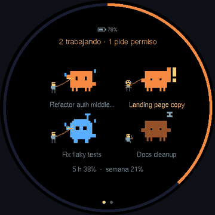
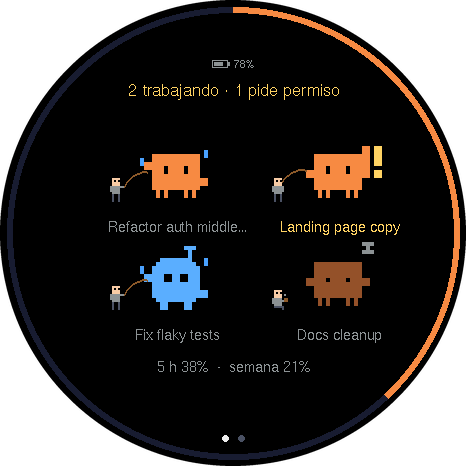
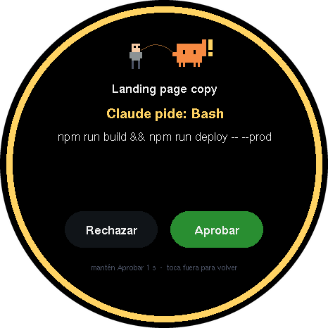
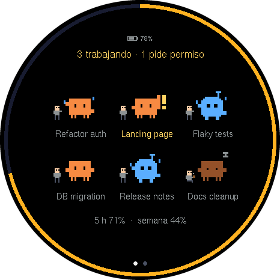
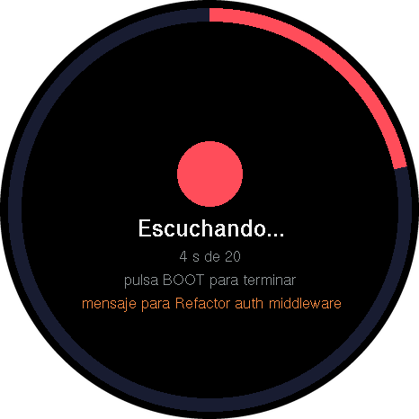
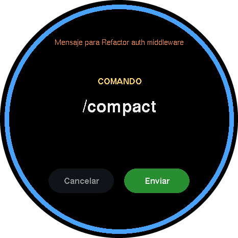
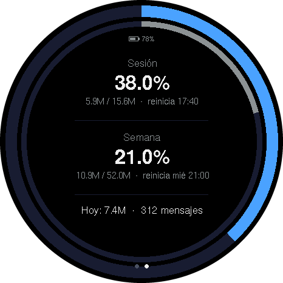
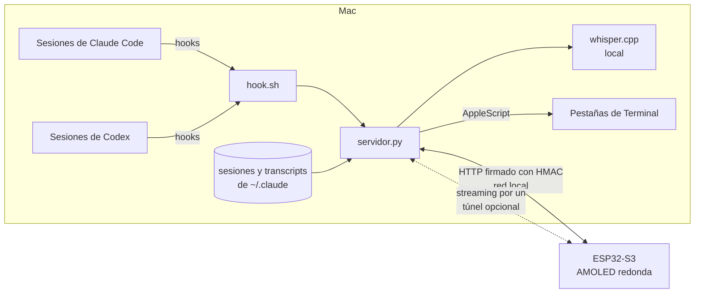

# claude-panel

**Una pantalla redonda de escritorio que muestra tus sesiones de Claude Code y Codex, te deja aprobar permisos con un toque y crear sesiones por voz.**

[English](README.md) · [Español](README.es.md)

Cada sesión abierta en tu Mac es un muñequito pixel: **naranja para Claude Code, azul para Codex**. Se animan según su estado: trabajando, pidiendo permiso, esperando tu respuesta o en espera (con siesta y café). Un anillo delgado muestra cuánto llevas del bloque de uso de 5 horas.

> Todas las imágenes son cuadros reales sacados del framebuffer de la placa en **modo demo** (sesiones ficticias, sin datos reales).

## Qué hace

| | |
|---|---|
|  | **Vista general.** Hasta 6 sesiones; cada una conserva su lugar. Arriba, cuántas trabajan y cuántas esperan; abajo, el bloque de 5 h y la semana. |
|  | **Aprobar o rechazar desde la placa.** Cuando una sesión pide permiso, la placa suena y muestra la herramienta y el comando. *Rechazar* es un toque; *Aprobar* pide mantener 1 s. También puedes contestar en la Mac: gana la primera respuesta. |
|  | **Claude y Codex juntos.** Las sesiones de Codex se detectan con sus hooks. Las consultas que hace Claude con el plugin de Codex aparecen mientras trabajan y se quitan al terminar. |
|  | **Voz.** Pulsa BOOT, habla y vuelve a pulsar. El audio se transcribe **en la Mac** con whisper.cpp. Desde la pantalla principal crea una sesión nueva; desde el detalle de una sesión le manda un mensaje. |
|  | **Comandos por voz, lista cerrada.** "comando compactar" → `/compact`, "comando limpiar" → `/clear`, "comando salir" → `/exit` (Codex: `/quit`). Los que borran piden mantener Enviar y la sesión en espera. |
|  | **Consumo.** Desliza para ver el bloque de 5 h, la semana y el día, calibrados contra claude.ai → Usage. |
| | **Batería y cuidado de la pantalla.** El nivel de batería (con un rayo mientras carga) se lee del AXP2101 y aparece pequeño arriba en la vista general y la de consumo. Para cuidar la AMOLED, el brillo baja tras 2 min sin toques ni cambios en las sesiones y la pantalla se apaga a los 10; un toque, BOOT o un permiso nuevo la despiertan (el toque o la pulsación que despierta no hace nada más). Cada 3 min el cuadro completo se mueve 1–3 px para no marcar el anillo ni los textos fijos. El botón PWR queda como viene (presión larga apaga). |

Más pantallas: [detalle de una sesión](docs/img/detalle.png) · [sesión nueva por voz](docs/img/mensaje.png).

## Cómo funciona

| Archivo | Qué hace |
|---|---|
| `servidor.py` | Servidor HTTP, solo biblioteca estándar. Lee `~/.claude/sessions`, los transcripts y los hooks; arma el estado para la placa; retiene los permisos hasta que la placa contesta. |
| `hook.sh` | Hook de Claude Code y Codex (`hook.sh codex`). Reenvía eventos; en `PermissionRequest` espera la decisión de la placa. |
| `voz.py` | Transcripción local (whisper.cpp), lanzar sesiones en Terminal y escribir mensajes en la pestaña de una sesión abierta. |
| `firmware/` | PlatformIO + Arduino (pioarduino), Arduino_GFX, U8g2, ArduinoJson, SensorLib, XPowersLib. Drivers de audio ES8311/ES7210 de Espressif. |
| `herramientas/captura.py` | Saca el framebuffer de la placa por USB en modo demo y genera los PNG y el GIF de este README. |

## Hardware

[Waveshare ESP32‑S3‑Touch‑AMOLED‑1.75C](https://www.waveshare.com/esp32-s3-touch-amoled-1.75c.htm): ESP32‑S3R8, AMOLED redonda 466×466 (CO5300, QSPI), touch CST9217, códec de bocina ES8311, dos micrófonos ES7210, PMU AXP2101 y batería LiPo pequeña.

## Puesta en marcha

1. `cp .env.example .env.local` y define `PANEL_TOKEN` (largo y aleatorio).
2. `cp firmware/include/secrets.example.h firmware/include/secrets.h` y llena el WiFi, el mismo token y el nombre mDNS de tu Mac.
3. Servidor: `python3 -I servidor.py` (o como agente de launchd).
4. Hooks: en `~/.claude/settings.json` apunta `SessionStart`, `UserPromptSubmit`, `Notification`, `PostToolUse`, `Stop` y `SessionEnd` a `hook.sh`; agrega `PermissionRequest` (timeout 600) y un `PreToolUse` con matcher `AskUserQuestion`. En `~/.codex/hooks.json`, los mismos eventos con `hook.sh codex` (Codex pide aprobar los hooks nuevos con `/hooks`).
5. Voz: `brew install whisper-cpp` y descarga `ggml-large-v3-turbo-q5_0.bin` a `modelos/`.
6. Firmware: `pio run -t upload` dentro de `firmware/`.

## Seguridad

- Los hooks solo se aceptan desde la propia Mac, nunca por el túnel.
- Aprobar o rechazar exige la firma HMAC de la placa; cada permiso se contesta una sola vez y nunca crea reglas de "permitir siempre".
- Se rechazan peticiones del navegador (encabezado `Origin`) y nombres de `Host` ajenos (CSRF / DNS rebinding).
- Antes de teclear en una terminal, el servidor vuelve a comprobar que sea el mismo proceso, la misma tty, en primer plano y sin suspender. Se quitan `!`, `/` y `#` al inicio del texto dictado; los comandos salen de una lista cerrada.
- Por el túnel, títulos y comandos se reemplazan por carpeta y herramienta. La placa no verifica el TLS del túnel (el HMAC protege la integridad, no la confidencialidad).

## Aviso

Proyecto personal. No está afiliado ni respaldado por Anthropic ni OpenAI, ni es un producto suyo. Claude, Claude Code y Codex son marcas de sus respectivos dueños. Los muñequitos pixel son diseños originales.

## Licencia

[Apache-2.0](LICENSE). Los drivers de audio en `firmware/lib/` conservan sus avisos de copyright y licencias originales de Espressif (Apache‑2.0 y MIT).
