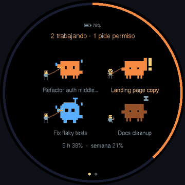
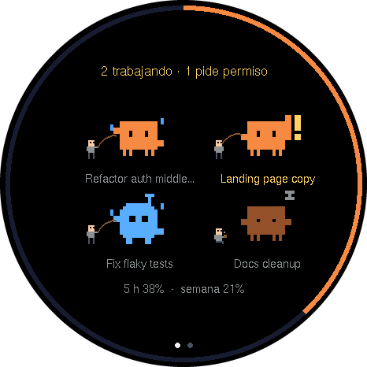
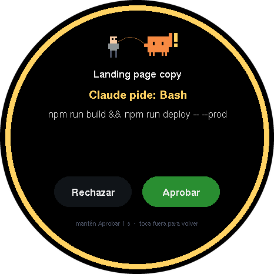
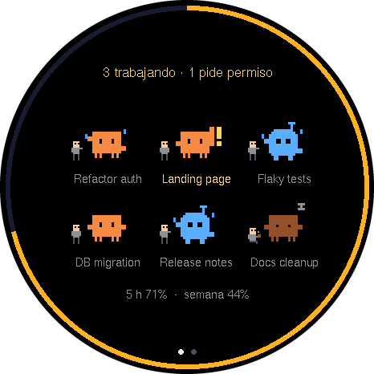
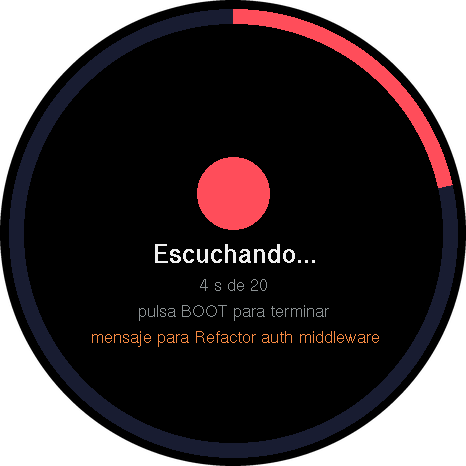
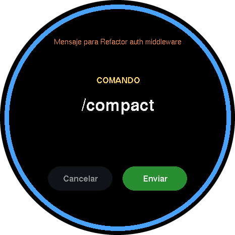
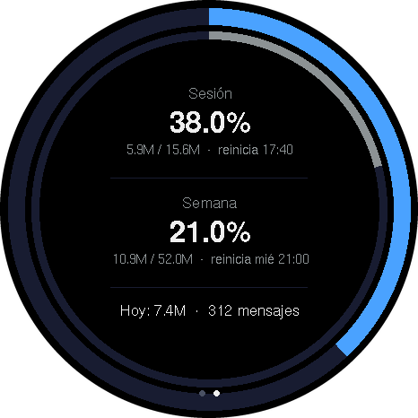
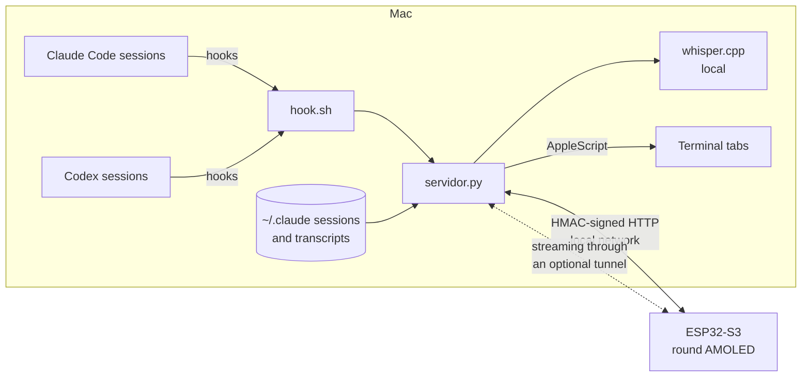

# claude-panel

**A round desk display that shows your Claude Code and Codex sessions, lets you approve permissions with a tap and start sessions by voice.**

[English](README.md) · [Español](README.es.md)

Each open session on your Mac becomes a small pixel character: **orange for Claude Code, blue for Codex**. They animate by state — working, waiting for your permission, waiting for your answer, or idle (napping next to a coffee). A thin ring shows how much of the current 5‑hour usage block you have spent.

> The on‑device UI is in Spanish. All screenshots below are real frames dumped from the board's framebuffer in **demo mode** (fictional sessions, no real data).

## What it does

| | |
|---|---|
|  | **Session overview.** Up to 6 sessions, each keeps its spot on screen. The header counts sessions working and waiting; the footer shows the 5‑hour block and weekly usage. |
|  | **Approve or reject from the board.** When a session asks for permission the board beeps and shows the tool and command. *Reject* is a tap; *Approve* needs a 1‑second hold. Answering on the Mac also works — whichever answers first wins. |
|  | **Claude and Codex side by side.** Codex sessions are detected through Codex hooks. Consultations that Claude makes through the Codex plugin show up while they work and disappear when done. |
|  | **Voice.** Press the BOOT button, speak, press again. The audio is transcribed **locally** with whisper.cpp on the Mac. From the main screen it starts a new session; from a session's detail it sends a message to that session. |
|  | **Voice commands, closed list.** "comando compactar" → `/compact`, "comando limpiar" → `/clear`, "comando salir" → `/exit` (Codex: `/quit`). Destructive ones need a hold and an idle session. |
|  | **Usage.** Swipe for the 5‑hour block, the week and today, calibrated against claude.ai → Usage. |

More screens: [session detail](docs/img/detalle.png) · [new session from voice](docs/img/mensaje.png).

## How it works

| File | Role |
|---|---|
| `servidor.py` | HTTP server, Python standard library only. Reads `~/.claude/sessions`, transcripts and hook events; builds a compact state for the board; holds permission requests until the board answers. |
| `hook.sh` | Hook for Claude Code and Codex (`hook.sh codex`). Forwards events; on `PermissionRequest` it waits for the board's decision. |
| `voz.py` | Local transcription (whisper.cpp), launching sessions in Terminal, typing messages into an existing session's tab. |
| `firmware/` | PlatformIO + Arduino (pioarduino), Arduino_GFX, U8g2, ArduinoJson, SensorLib. Vendored ES8311/ES7210 audio drivers from Espressif. |
| `herramientas/captura.py` | Dumps the board's framebuffer over USB in demo mode and writes the PNGs/GIF used here. |

## Hardware

[Waveshare ESP32‑S3‑Touch‑AMOLED‑1.75C](https://www.waveshare.com/esp32-s3-touch-amoled-1.75c.htm): ESP32‑S3R8, 466×466 round AMOLED (CO5300, QSPI), CST9217 touch, ES8311 speaker codec, ES7210 dual microphones, AXP2101 PMU, small LiPo battery.

## Setup

1. `cp .env.example .env.local` and set `PANEL_TOKEN` (long and random).
2. `cp firmware/include/secrets.example.h firmware/include/secrets.h` and fill in Wi‑Fi, the same token and your Mac's mDNS name.
3. Run the server: `python3 -I servidor.py` (or as a launchd agent).
4. Hooks — in `~/.claude/settings.json` point `SessionStart`, `UserPromptSubmit`, `Notification`, `PostToolUse`, `Stop` and `SessionEnd` to `hook.sh`; add `PermissionRequest` (timeout 600) and a `PreToolUse` hook with matcher `AskUserQuestion`. In `~/.codex/hooks.json` use the same events with `hook.sh codex` (Codex asks you to approve new hooks with `/hooks`).
5. Voice: `brew install whisper-cpp` and download `ggml-large-v3-turbo-q5_0.bin` into `modelos/`.
6. Firmware: `pio run -t upload` inside `firmware/`.

## Security

- Hooks are only accepted from the Mac itself, never through the tunnel.
- Approving or rejecting requires an HMAC signature from the board; each request can be answered once and never creates "always allow" rules.
- Browser requests (`Origin` header) and foreign `Host` names are rejected (CSRF / DNS rebinding).
- Before typing into a terminal, the server re‑checks that it is the same process, the same tty, in the foreground and not suspended. Leading `!`, `/` and `#` are stripped from dictated text; commands come from a closed list.
- Through the tunnel, session titles and commands are replaced by folder and tool names. The tunnel's TLS is not verified on the board (HMAC protects integrity, not confidentiality).

## Disclaimer

Personal project. Not affiliated with, endorsed by or a product of Anthropic or OpenAI. Claude, Claude Code and Codex are trademarks of their respective owners. The pixel characters are original designs.

## License

[Apache-2.0](LICENSE). The vendored audio drivers in `firmware/lib/` keep their original Espressif copyright notices and licenses (Apache‑2.0 and MIT).
